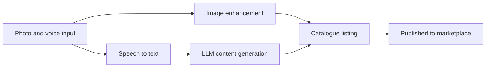

<div align="center">

# 🎨 Srijan

### *Turning an artisan's phone camera into an online shop.*

**An AI-driven market linkage and smart cataloging app for marginalized artisans. One photo, a few spoken words, and a ready-to-sell product listing.**

[](#-about-the-hackathon)
[](#-about-the-hackathon)
[](#-about-the-hackathon)
[](#-about-the-hackathon)

[**📄 Presentation**](SIH-2026-Srijan.pdf) · [**✨ Features**](#-key-features) · [**🧭 How It Works**](#-how-it-works) · [**🛠️ Tech Stack**](#️-tech-stack) · [**👥 Team**](#-team-srijan)

</div>

---

## 📌 Table of Contents

- [About the Hackathon](#-about-the-hackathon)
- [The Problem](#-the-problem)
- [Our Idea](#-our-idea)
- [Key Features](#-key-features)
- [How It Works](#-how-it-works)
- [Challenges and Our Approach](#-challenges-and-our-approach)
- [Expected Impact](#-expected-impact)
- [Tech Stack](#️-tech-stack)
- [Repository Contents](#-repository-contents)
- [Team Srijan](#-team-srijan)
- [References](#-references)

---

## 🏆 About the Hackathon

**Internal Smart India Hackathon 2026, Pondicherry University**
Department of Computer Science, School of Engineering and Technology · 17.09.2026

| | |
|---|---|
| **Problem Statement ID** | SIH26090 |
| **Theme** | Heritage & Culture |
| **Category** | Software |
| **Team** | Srijan (Team ID: P49) |

---

## ❗ The Problem

Marginalized artisans depend on **seasonal fairs** for their income. With no year-round online selling and limited digital skills, their customers, market reach and earnings stay restricted.

## 💡 Our Idea

An AI-powered mobile app that turns an artisan's phone camera into an online shop. With **one photo and a few spoken words**, the AI improves the image, writes the product listing, suggests a price, and helps sell products throughout the year.

---

## ✨ Key Features

| | Feature | Description |
|---|---|---|
| 📸 | **AI Image Studio** | Removes background clutter, improves lighting and enhances product photos for online selling. |
| 🗣️ | **Multilingual Auto-Cataloger** | Artisans describe products by voice in regional languages, and AI writes Hindi and English descriptions that keep the artisan's own story. |
| 💰 | **Dynamic Pricing Assistant** | Suggests a selling price from raw material costs, product details and current market trends. |
| 🏪 | **Digital Storefront and Analytics** | A year-round online marketplace with a simple dashboard for orders, earnings and demand trends. |
| 🎙️ | **Voice-first, low-literacy-friendly** | Complex tasks stay behind a simple interface so artisans can focus on their craft. |

---

## 🧭 How It Works



| Step | What happens |
|:---:|---|
| **1** | **Input.** The artisan uploads a product photo and describes the product by voice. |
| **2** | **Image processing.** Cloudinary enhances the image, removes the background and sets a new one. |
| **3** | **Speech to text.** Whisper converts the seller's voice into text. |
| **4** | **Content generation.** An LLM creates the title, description and catchy tags. |
| **5** | **Data repository.** The processed image and generated content are stored. |
| **6** | **Listing creation.** Image, title, description and tags combine into a catalogue listing. |
| **7** | **Marketplace integration.** The listing is published to online marketplaces and goes live. |

---

## 🛡️ Challenges and Our Approach

| Challenge | Our approach |
|---|---|
| Data security and privacy (unauthorized access, third-party APIs) | Encrypted API connections and strong user authentication |
| Limited digital awareness | Simple navigation and regional language support |
| High traffic in peak seasons and slow AI processing | Cloud auto-scaling and optimized image processing |

---

## 🌱 Expected Impact

| | Area | Impact |
|---|---|---|
| 🤝 | **Social** | Dignity and a connected community for artisans, and preservation of traditional crafts. |
| 💵 | **Economic** | Year-round income and higher earnings by cutting out middlemen. |
| 🌿 | **Environmental** | Less travel to physical fairs and promotion of low-impact, natural-material crafts. |
| 📚 | **Learning** | Builds digital and financial literacy through repeated, guided use. |
| 🤖 | **Technological** | Introduces AI tools to first-time digital users. |

---

## 🛠️ Tech Stack

| Layer | Technology |
|---|---|
| **Frontend** | Flutter / Dart |
| **Backend** | Node.js, Express.js |
| **Database** | PostgreSQL / Supabase |
| **AI and ML** | Python, OpenAI Whisper, OpenCV, LLMs |
| **Image Processing** | Cloudinary (enhancement, background removal, per-category backgrounds) |
| **Content Generation** | ChatGPT / DeepSeek (title, description, catchy words and tags) |
| **API Services** | REST API |
| **Deployment and Tools** | AWS / Render, Docker, GitHub, Git |

---

## 📁 Repository Contents

```
SIH-2026-Srijan/
├── README.md                 # Project overview
├── SIH-2026-Srijan.pdf       # Presentation (PDF)
└── SIH-2026-Srijan.pptx      # Presentation (editable)
```

📄 [**View the presentation (PDF)**](SIH-2026-Srijan.pdf)

---

## 👥 Team Srijan

| Member |
|---|
| **Raunak Dubey** |
| **Sahil Kumar Singh** |
| **Yash Pathak** |
| **Vikram Kumar Modi** |
| **Prem Kumar Devangan** |
| **Muskan Rathore** |

**Maintained by** [](https://github.com/raunakdubey7891-del)

---

## 📚 References

- [Ministry of Social Justice and Empowerment, Scheme 13](https://socialjustice.gov.in/schemes/13)
- [Ministry of Social Justice and Empowerment, Scheme 100](https://socialjustice.gov.in/schemes/100)
- [Ministry of Social Justice and Empowerment, Scheme 104](https://socialjustice.gov.in/schemes/104)
- [Ministry of Social Justice and Empowerment, Scheme 99](https://socialjustice.gov.in/schemes/99)
- [Ministry of Social Justice and Empowerment, Scheme 32](https://socialjustice.gov.in/schemes/32)

---

<div align="center">

⭐ If you like this idea, please consider giving the repo a star! ⭐

*Made with ❤️ for the artisans who keep our heritage alive.*

</div>
